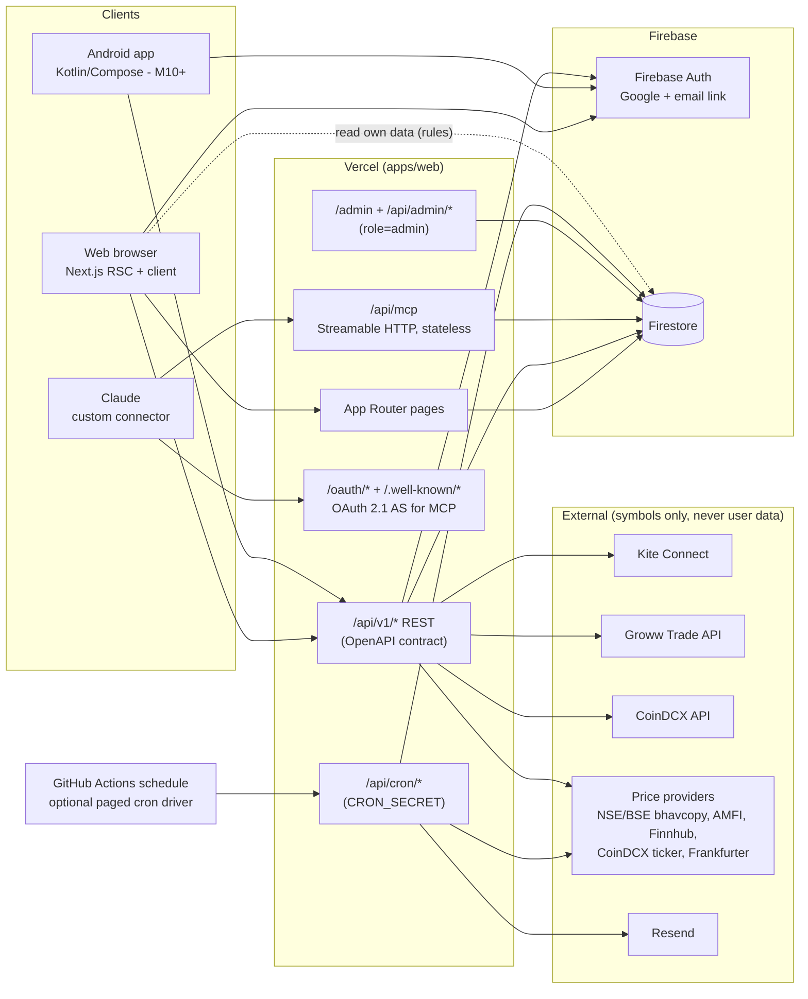
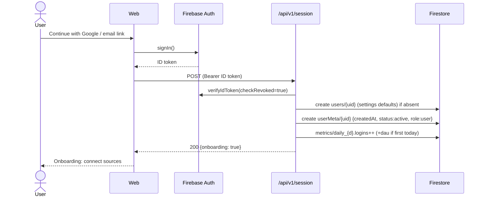
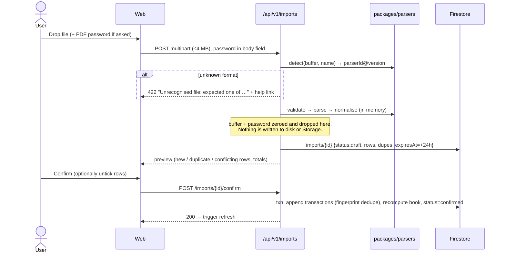
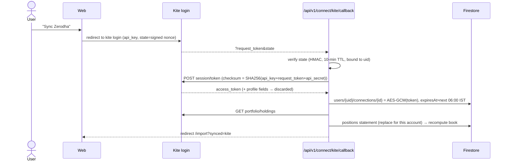
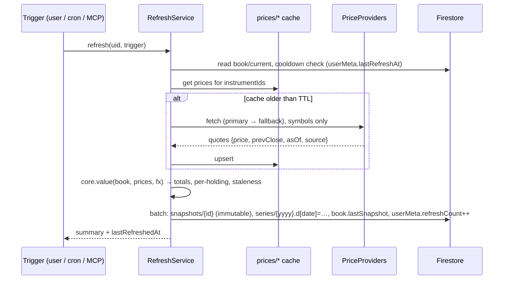
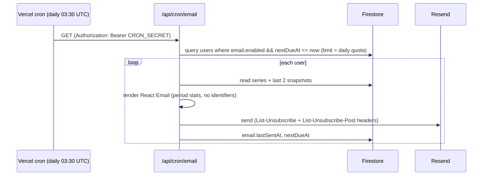
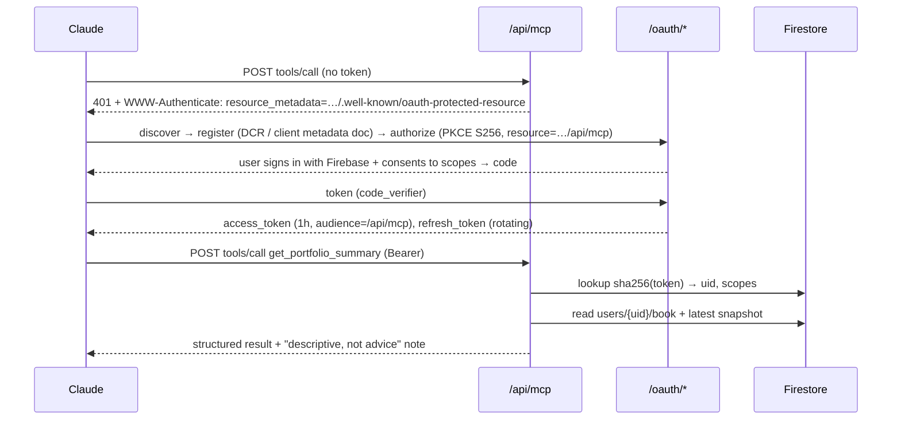
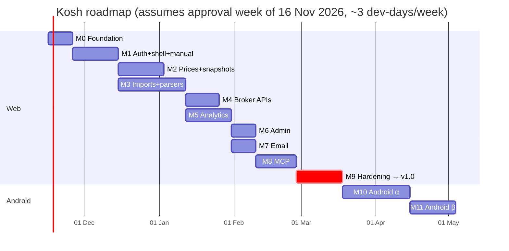

# Kosh — Architecture & Product Plan (v0.1, for approval)

> **Kosh** (कोश, "treasury / store of value") — *Every investment. One ledger.*
> Open-source, multi-user investment tracker for Indian investors holding Indian + US equities, mutual funds, unlisted shares and crypto.
>
> Status: **DRAFT — awaiting your approval.** Nothing has been scaffolded, deployed, or pushed.
> Research date for every third-party claim: **2026-11-09** (web search). Sources are listed as `[S#]` in the appendix. Anything not confirmed from a primary source is labelled **unverified**.

---

## 0. Name & brand

| Option | Why | Risk |
|---|---|---|
| **Kosh** *(recommended)* | 4 letters, easy to say in every Indian language, means "treasury". The **K** mark doubles as a rising chart. A web search found no portfolio app by this name (2026-11-09). | Domain and trademark availability **unverified**. Check `kosh.app`, `getkosh.in`, GitHub org `kosh-finance`, and an Indian trademark search (class 9/36) before launch. |
| Sampada | "Wealth". Warm. | Longer. Common word, so it's harder to search for. |
| Foliyo | Portfolio + Hindi "-yo". | Feels like a brand pun and is easy to misspell. |

**Logo concept:** a rounded-square indigo tile with a white **K**. The K's upper arm is a rising trend line that ends in a **gold point**: "the latest price". The lower leg grounds it. It stays legible at 16 px. The colours are chosen to stay clear of gain/loss green and red, so the brand never reads as "profit" or "loss".

Files (in `brand/`):

- `kosh-mark.svg`: primary app icon / favicon
- `kosh-mark-mono.svg`: single-colour version
- `kosh-lockup.svg`: horizontal mark + wordmark (outline the text before release)
- `brand-sheet.html`: preview of lockups, sizes, palette, and number styling

---

## 1. Executive Summary

Kosh is a Next.js (App Router) web app on Vercel with Firebase Auth + Firestore. It is designed to run **entirely on free tiers** for a personal or small instance. To stay on Firebase Spark, it uses **no Cloud Functions and no Cloud Storage**: uploaded files are parsed in memory and discarded immediately.

Each source uses the most official route that actually works today:

- **Kite Connect** (free "Personal" API, bring-your-own app key) for live Zerodha holdings, plus the Console tradebook file for history.
- **File upload** for Groww, INDmoney and CoinDCX.
- **CAMS/KFintech CAS PDF** for mutual funds.
- **Manual entry** for unlisted shares.

The Groww API exists but is paid and its tokens expire daily, so it is optional.

Portfolio data is **event-sourced**: transactions produce a per-user "book" read-model. Every refresh writes an **immutable snapshot**. Returns (TWR per period, XIRR, CAGR, FIFO realised P&L) are computed in a pure, fully tested `packages/core`. Prices come through a pluggable `PriceProvider` with a **shared global cache**, so free API limits scale with the number of unique instruments, not the number of users.

A remote **MCP server** lives inside the web app (stateless Streamable HTTP, per-user OAuth 2.1, read-only by default). The admin console sees only pseudonymous metadata. An OpenAPI contract lets the later Kotlin/Compose app reuse the backend without duplicating business rules.

The web app reaches production v1.0 at **M9**, and Android starts after that.

---

## 2. Source Integration Feasibility

### 2.1 Summary

| Source | Chosen method (v1) | Auth | Data available | Limits / cost | Key risks | Citation |
|---|---|---|---|---|---|---|
| **Zerodha (Indian stocks)** | **Kite Connect API** for holdings (BYOK "Personal" app) **+** Console **Tradebook CSV** upload for history | OAuth-style redirect login → `request_token` → `access_token`; **no password ever touches Kite** | Holdings (qty, avg price, last price: **unverified** on the free plan). API trades cover **today only** (**unverified**), so full history must come from the tradebook file | Personal plan **free**; paid "Connect" plan ₹500/month adds live WebSocket + historical data [S1][S2]. Fee waiver for active traders from Oct 2026 (terms **unverified**) [S3] | Token expires daily around 06:00–08:00 IST, with conflicting reports [S4], so users re-login per sync. **The token has trading permission and there is no read-only scope**, so Kosh calls an allow-list of GET endpoints only. Multi-user use of a single operator app may need Zerodha approval (**unverified**), so we default to BYOK | [S1–S4] |
| **Groww (Indian stocks)** | **File upload** (holdings + order history XLSX) by default; **optional Groww Trade API** for holdings | API: user generates a daily access token in Groww settings (expires 06:00) [S5]. **We reject the key + secret + TOTP flow**, because it would mean storing a 2FA seed | `GET holdings/user`: demat holdings [S5] | ₹499/month + tax (**third-party source, unverified**) [S7]; rate limits 10/s, 250/min, 3,000/day for non-trading calls [S5] | Paid + daily token, so few users will use it. File format must come from your sample | [S5–S7] |
| **Groww (US stocks)** | File upload, if Groww still offers US stocks | – | – | – | Whether Groww still offers US stocks is **unverified**. Tell me if you hold any there | – |
| **INDmoney (Indian + US)** | **File upload** | None (no public API found → **unverified**) | Indian: Holding Statement per FY under reports [S8]. US: transactions / holdings / tax P&L reports are downloadable [S9]. The exact menu path conflicts between sources [S8][S10] | Free | Format unknown until your sample arrives. The US statement may be in USD with or without the INR conversion | [S8–S10] |
| **Mutual funds** | **CAMS/KFintech Detailed CAS PDF** upload (password-protected) | Password entered at upload, kept in memory only | Detailed CAS: folios, schemes, ISIN/AMFI code, transactions, closing units/value [S11][S12] | Free; request via CAMS / KFintech / MFCentral [S11]. Period cap of 365 days for "specific period" requests [S12] | Password rule conflicts: user-set at request vs. PAN in caps [S14]. We just ask. MFCentral output format differs (support CAMS first). MFCentral "QR code" is a third-party data-sharing flow [S15], **out of scope for v1** | [S11–S15] |
| **Unlisted shares** | **Manual entry** (qty, buy price, date) + **manual current price**; optional "suggested price" lookup later | – | – | Free | Public sites publish **indicative dealer quotes**, which vary widely between sites [S18][S19]. Scraping only after a ToS/robots review, so it is **off by default** | [S18][S19] |
| **Crypto (CoinDCX)** | **Trade-history file upload** (v1); **read-only API key** (M4, only if CoinDCX offers a read-only permission: **unverified**) | API: key + secret, HMAC-SHA256 signed [S16] | Trades, fees, deposits/withdrawals (file); balances via API | Free | Read-only scope not confirmed [S17]. An API key covers one (sub-)account only [S17] | [S16][S17] |
| **Cross-broker fallback (Indian demat)** | **NSDL/CDSL depository CAS** (monthly, covers every demat account) | Password-protected PDF | Holdings across Zerodha / Groww / INDmoney demat accounts | Free | **Unverified in this research pass**. Will verify before M3. Holdings only, no cost basis | – |

### 2.2 RBI Account Aggregator (future)

- A Financial Information User (FIU) **must be an entity registered with and regulated by a financial-sector regulator** (RBI / SEBI / IRDAI / PFRDA) [S32]. Under RBI direction, an FIU may also need to be an FIP [S32].
- A technology provider can build the FIU module, but the **regulated entity holds the licence and the obligations** [S32].
- **Feasibility for an open-source project: not feasible directly.** A self-hoster could only use AA by partnering with a licensed FIU, which defeats self-hosting.
- **Recommendation:** design `IngestionSource` so an `aa` source type can be added later, and park it at **M11+** as "requires a regulated partner". Equity and MF data over AA are reported as live, but only by unofficial sources (**unverified**).

### 2.3 Hard rules

1. **No broker password is ever requested, transmitted or stored.** The only credentials Kosh ever holds:
   - OAuth access tokens (Kite)
   - user-generated API tokens (Groww daily token, CoinDCX read-only key)
   - the user's own Kite app `api_secret` (BYOK)

   All are AES-256-GCM encrypted at rest.
2. Broker clients expose **only read endpoints**. Order or modify endpoints aren't even implemented, and a unit test fails if any non-GET method appears in `packages/integrations`.
3. PII returned by brokers (name, email, PAN in a profile/session response) is **discarded on receipt**. Only a salted hash of the broker user ID is kept, to detect "same account connected twice".

---

## 3. Files I Need From You

> **Do not send real files in chat.** When we reach M3, put redacted samples in `packages/parsers/fixtures/_incoming/` locally. That folder is git-ignored, and a pre-commit hook blocks PAN, email or phone patterns. For PDFs, run the local helper `pnpm fixture:extract <file.pdf>`. It decrypts the PDF locally, dumps the text items to JSON, and auto-redacts PAN, email, phone and folio/DP numbers with consistent fake values. You review the JSON, and the parser is built against that. Menu paths below come from third-party guides and **may be outdated**.

| # | Source | Export (menu path: **verify in the current app**) | File type | Date range | Purpose |
|---|---|---|---|---|---|
| F1 | Zerodha | Console → Reports → **Tradebook** → Segment: Equity → Download | CSV (and XLSX if offered) | From account opening (do it in yearly chunks if the range is capped) | Full transaction history |
| F2 | Zerodha | Console → Portfolio → **Holdings** → Download | XLSX/CSV | Current | Reconcile vs. API |
| F3 | Groww | Profile → Reports → Stocks → **Holdings statement** | XLSX | Current | Holdings |
| F4 | Groww | Profile → Reports → Stocks → **Order history / Transactions** | XLSX | From first trade | History |
| F5 | INDmoney | Profile → Tax and Other Reports → Other Reports → **INDstocks / Indian Stocks → Holding Statement** [S8] | PDF/XLSX (whatever it offers) | Current FY | Indian holdings |
| F6 | INDmoney | US Stocks → Manage → **Account Statement**, *or* Other Reports → US Stocks [S8][S10] | PDF/CSV/XLSX | From first trade | US transactions + holdings |
| F7 | INDmoney | Tax Centre → **Tax P&L** (US + Indian) | XLSX/PDF | Each FY | Realised P&L cross-check |
| F8 | Mutual funds | camsonline.com → Investors → Statements → **CAS – CAMS + KFintech** → *Detailed*, *Specific period* (inception → today; 365-day cap applies to some request types [S12]), *with zero-balance folios*, set a password | PDF (password) | Inception → today | MF ledger |
| F9 | Mutual funds | MFCentral → CAS → **Detailed** → FY [S13] | PDF | Latest FY | Second format (later) |
| F10 | CoinDCX | Profile/Reports → **Download trade history** (Spot) + **Deposits & withdrawals** | XLSX/CSV | From account creation | Crypto ledger |
| F11 | Demat (optional) | NSDL or CDSL monthly **CAS** email | PDF (password) | Latest month | Cross-broker fallback |

**Redact (replace with consistent fakes; keep column headers, number formats, date formats and row order untouched):**

- full name, nominee names
- PAN (→ `ABCDE1234F`)
- email, phone, address
- DP ID / Client ID / BO ID / demat account no. (→ `IN000000-00000000`)
- folio numbers (→ `F0000001`, `F0000002`, …: keep distinct)
- bank account / IFSC, UPI IDs
- CoinDCX user ID, wallet addresses, tx hashes
- KYC / CKYC numbers

**Keep:** ISINs, scheme names, symbols, quantities, prices, dates, fees. It's fine to scale all amounts by one constant if you prefer; tell me the factor.

**No parser is built from a guessed format.** Each parser milestone task starts with "sample received → format documented in `docs/parsers/<source>.md`".

---

## 4. System Architecture

### 4.1 Context & containers



**Key properties**

- **Clients read their own data directly from Firestore** (fast, real-time, guarded by rules). **All writes go through the server**, which validates, recomputes the book and writes atomically.
- **Admin SDK bypasses security rules**, so the admin privacy guarantee for server code is enforced by:
  - (a) a separate `AdminMetaRepository`, the only data module admin routes may import (ESLint `no-restricted-imports`)
  - (b) contract tests asserting admin responses contain only allow-listed fields
  - (c) Firestore rules for any client-side access
- Everything sent to price providers is **instrument identifiers only**.

### 4.2 Sequence diagrams

**Sign-up**



**File import (preview → confirm)**



**API sync (Kite)**



**Refresh + snapshot**



**Weekly / monthly email**



**MCP query**



**Admin delete**

```mermaid
sequenceDiagram
  actor AD as Admin
  participant UI as /admin
  participant AA as /api/admin/users/{id}
  participant FA as Firebase Auth
  participant FS as Firestore
  AD->>UI: Delete user u_7f3a… → type ID to confirm + reason
  UI->>AA: DELETE (admin ID token, recent auth ≤5 min)
  AA->>AA: verify role=admin claim + auth_time
  AA->>FS: adminAudit/{id} {actor, action:delete, target, reason, at} (written first)
  AA->>FA: revokeRefreshTokens + disable
  AA->>FS: revoke oauthTokens where uid; delete connections (tokens)
  AA->>FS: recursiveDelete(users/{uid}); delete userMeta/{uid}
  AA->>FA: deleteUser(uid)
  AA->>FS: adminAudit/{id}.status = completed
  AA-->>UI: 200
```

### 4.3 Architecture Decision Records

All ADRs live in `docs/adr/NNNN-title.md` (MADR format). Summary:

| ADR | Decision | Why | Would change if… |
|---|---|---|---|
| 0001 | **pnpm workspaces + Turborepo** monorepo | Boring, fast, first-class on Vercel; shared TS packages | Android-only team → Gradle-first repo split |
| 0002 | **MCP server as a route inside `apps/web`** (`/api/mcp`), not a separate app | Same domain for OAuth + Firebase session, shared domain code, one deployment, one set of secrets. The 2026-07-28 MCP spec is stateless, which fits serverless [S25] | MCP traffic dwarfs web traffic, or needs a different runtime/region → split to `apps/mcp` (the code already lives in `packages/mcp-tools`, so it's a cheap move) |
| 0003 | **Firebase Spark-first: no Cloud Functions, no Cloud Storage** | Scheduled functions need Blaze [S29]. Storage buckets reportedly need a billing account since Feb 2026 [S29]. All compute runs on Vercel instead | You accept Blaze (pay-as-you-go with budget alerts) → move cron to Cloud Scheduler |
| 0004 | **Client read-only Firestore; server-only writes** | One place for validation, book recomputation, audit; simpler rules | Offline-first Android writes needed → add narrowly-scoped client write rules |
| 0005 | **Event-sourced ledger + `book/current` read model** | Transactions are the truth. Holdings, cost basis and cash flows are derived, rebuildable, and testable. One-doc read keeps Firestore reads tiny | Portfolios over ~2,000 positions → shard book docs |
| 0006 | **Immutable snapshots + yearly `series` rollup** | Audit trail of every refresh. Charts read 1 doc per year instead of 365 | Need intraday charts → add `seriesIntraday/{date}` |
| 0007 | **Pluggable `PriceProvider` + global per-instrument cache** | Free API limits scale with unique instruments, not users | Paid data licence acquired → swap primary provider |
| 0008 | **Zero file retention: parse in memory** | Strongest privacy story, no Storage bill, no deletion jobs | Files >4 MB (Vercel body limit, **unverified** current value) → signed direct upload to a temp bucket with 1-hour lifecycle |
| 0009 | **AES-256-GCM envelope encryption for tokens**, key in env, key-ID versioned, AAD = `uid:connectionId` | Simple, auditable, rotation-ready | Move to Google Cloud KMS when on Blaze |
| 0010 | **Kite BYOK**: each user registers their own free Personal app | Free, compliant with personal-use plan [S1]. No operator-wide trading-capable app | Zerodha confirms multi-user "Connect" app terms → offer an operator app as an option |
| 0011 | **Built-in OAuth 2.1 AS for MCP** (PKCE, DCR + Client ID Metadata Documents, RFC 8707 resource indicators, opaque hashed tokens) | Firebase Auth is not an OAuth AS for third-party clients. Own AS = no extra vendor, works for self-hosters [S24] | You prefer managed: WorkOS/Auth0/Stytch free tiers (**unverified** limits) |
| 0012 | **FIFO lot accounting** for realised P&L; display average cost of open lots | Matches how Indian capital gains are computed for securities (**unverified as legal advice**; we're descriptive only) | Users ask for broker-style average cost → add a display toggle (maths unchanged) |
| 0013 | **shadcn/ui Charts (Recharts)** for all v1 charts | Matches the design system and theme tokens. Handles ≤ few thousand points. One library | Candlesticks / intraday >10k points → TradingView Lightweight Charts (Apache-2.0, attribution required) for time-series only |
| 0014 | **Resend + React Email** | Free tier 3,000/month, 100/day [S30]. JSX templates live in a package | >100 emails/day on free → Resend Pro or Brevo; self-hosters can plug in SMTP via the `Mailer` interface |
| 0015 | **OpenAPI 3.1 contract generated from Zod** (`packages/contracts`) → typed TS client + Kotlin client via openapi-generator | One source of truth. Android doesn't reimplement maths | gRPC/GraphQL needed (unlikely) |
| 0016 | **Licence: AGPL-3.0** (proposed) | Keeps hosted forks open (finance trackers like this commonly use it). Still free for self-hosters | You want maximum reuse in closed apps → MIT / Apache-2.0 |
| 0017 | **Decimal arithmetic (`decimal.js`)** for money and qty; amounts stored as strings | No float drift in P&L. XIRR solves in float64 (it's a rate) | – |
| 0018 | **Scheduling: Vercel cron (daily) + optional GitHub Actions paged driver** | Hobby cron = once/day, ±59 min precision; up to 100 cron jobs per project [S27]. Functions cap at 60 s on Hobby [S28], so long jobs are paged with a cursor | Vercel Pro → per-minute cron, drop GHA |

---

## 5. Data Model & Security Rules

### 5.1 Collections

```text
users/{uid}                         owner-read; settings-only owner-update
  accounts/{accountId}              source connections (non-secret metadata)
  connections/{connectionId}        ENCRYPTED tokens — no client access at all
  transactions/{txnId}              ledger (append-only; edits = reversing entries)
  corporateActions/{caId}           user-applied splits/bonuses/mergers
  book/current                      derived read model (positions + cash flows)
  snapshots/{snapshotId}            immutable refresh records
  series/{yyyy}                     compact daily totals for charts
  imports/{importId}                drafts (TTL 24h) + history of confirmed imports
  mcpAudit/{id}                     user-visible log of MCP calls/writes
userMeta/{uid}                      admin-visible, non-personal metadata
instruments/{instrumentId}          global instrument master (public data)
prices/{instrumentId}               latest cached quote (public data)
fx/{pair}                           latest FX; fxHistory/{pair_yyyy-mm-dd}
metrics/daily_{yyyy-mm-dd}          aggregate counters
adminAudit/{id}                     admin actions
oauthClients/{clientId}             MCP OAuth (server-only)
oauthGrants/{codeHash}              auth codes, 60 s TTL (server-only)
oauthTokens/{tokenHash}             access/refresh tokens (server-only)
rateLimits/{key}                    token buckets (server-only)
```

### 5.2 Types (`packages/core/src/model.ts`, abridged)

```ts
// packages/core/src/model.ts
type Decimal = string;            // decimal.js-serialised, e.g. "1234.5600"
type ISODate = `${number}-${number}-${number}`; // trade/value date, IST calendar
type AssetClass = 'IN_EQUITY' | 'US_EQUITY' | 'MUTUAL_FUND' | 'UNLISTED' | 'CRYPTO';
type Source = 'zerodha' | 'groww' | 'indmoney' | 'cas' | 'coindcx' | 'manual' | 'demat_cas';

interface UserDoc {
  settings: {
    baseCurrency: 'INR';
    numberFormat: 'indian' | 'international';
    theme: 'system' | 'light' | 'dark';
    staleness: { equityHours: number; mfHours: number; cryptoMinutes: number; unlistedDays: number };
    email: { enabled: boolean; frequency: 'weekly' | 'monthly'; weekday?: 0|1|2|3|4|5|6; nextDueAt?: Timestamp };
  };
  createdAt: Timestamp; updatedAt: Timestamp;
}

interface Account {          // users/{uid}/accounts/{accountId}
  source: Source; label: string;                // user-chosen label, e.g. "Zerodha – main"
  method: 'api' | 'file' | 'manual';
  brokerUserIdHash?: string;                   // HMAC(pepper, brokerUserId) – dedupe only
  lastSyncAt?: Timestamp; status: 'ok' | 'reauth_required' | 'error';
}

interface Connection {       // users/{uid}/connections/{id} — server-only
  accountId: string; provider: 'kite' | 'groww' | 'coindcx';
  ciphertext: string; iv: string; tag: string; keyId: string;  // AES-256-GCM
  expiresAt?: Timestamp; scopes: string[]; createdAt: Timestamp; revokedAt?: Timestamp;
}

interface Instrument {       // instruments/{instrumentId}
  id: string;                // e.g. "INE002A01018" (ISIN), "US:AAPL", "MF:120503", "CRYPTO:BTC", "UNL:<slug>"
  assetClass: AssetClass; name: string; currency: 'INR' | 'USD';
  isin?: string; nseSymbol?: string; bseCode?: string; usTicker?: string;
  amfiCode?: string; coinSymbol?: string;
  status: 'active' | 'delisted' | 'merged'; mergedInto?: string;
  holders: number;           // count of users holding → drives price refresh set
}

interface Transaction {      // users/{uid}/transactions/{txnId}
  accountId: string; instrumentId: string;
  type: 'BUY' | 'SELL' | 'DIVIDEND' | 'INTEREST' | 'FEE' | 'TAX_WITHHELD'
      | 'SPLIT' | 'BONUS' | 'MERGER_IN' | 'MERGER_OUT' | 'TRANSFER_IN' | 'TRANSFER_OUT'
      | 'OPENING_BALANCE' | 'REVERSAL';
  tradeDate: ISODate; settleDate?: ISODate;
  qty: Decimal; price?: Decimal; currency: 'INR' | 'USD';
  grossAmount?: Decimal; fees?: Decimal; feeCurrency?: string;
  fxRate?: Decimal; fxSource?: 'statement' | 'frankfurter' | 'manual';
  ratio?: { from: number; to: number };   // SPLIT/BONUS
  brokerRef?: string;                      // trade/order id when present
  fingerprint: string;                     // sha256(source|account|date|instrument|type|qty|price|brokerRef)
  importId?: string; parser?: string;      // "zerodha.tradebook@1.2.0"
  reversedBy?: string; createdAt: Timestamp;
}

interface Position {         // inside book/current.positions[positionId]
  accountId: string; instrumentId: string; assetClass: AssetClass; currency: 'INR'|'USD';
  qty: Decimal; openCostCcy: Decimal; openCostInr: Decimal; avgPriceCcy: Decimal;
  realisedInr: Decimal; dividendsInr: Decimal; feesInr: Decimal;
  firstAcquired: ISODate;
  origin: 'ledger' | 'statement' | 'manual';   // statement = holdings-only import (no history)
  cashflows: [ISODate, number][];              // INR, aggregated per day, for XIRR
  approxHistory: boolean;                       // true when opening lot is synthetic
  manualPrice?: { price: Decimal; asOf: ISODate };   // unlisted
}

interface Book { version: number; updatedAt: Timestamp; positions: Record<string, Position>;
                 lastSnapshot?: { id: string; at: Timestamp; valueInr: Decimal } }

interface Snapshot {         // users/{uid}/snapshots/{id} — never updated
  createdAt: Timestamp; trigger: 'manual' | 'scheduled' | 'import' | 'mcp';
  bookVersion: number; asOfDate: ISODate;
  fx: { USDINR: Decimal; source: string; asOf: Timestamp };
  totals: { valueInr: Decimal; investedInr: Decimal; unrealisedInr: Decimal;
            realisedInr: Decimal; dayChangeInr: Decimal; netFlowSincePrevInr: Decimal };
  byAssetClass: Record<AssetClass, { valueInr: Decimal; investedInr: Decimal }>;
  bySource: Record<string, { valueInr: Decimal; investedInr: Decimal }>;
  // compact rows to stay far below the 1 MiB doc limit
  rows: [positionId: string, instrumentId: string, qty: string, price: string, priceCcy: 'INR'|'USD',
         priceSource: string, priceAsOf: number /*epoch s*/, status: 'fresh'|'stale'|'missing'|'manual',
         valueInr: string, investedInr: string, dayChangeInr: string][];
}

interface SeriesYear {       // users/{uid}/series/{yyyy}
  d: Record<ISODate, { v: number; inv: number; flow: number; s: string /*snapshotId*/ }>;
}

interface UserMeta {         // userMeta/{uid} — the ONLY user data admins see
  createdAt: Timestamp; lastActiveAt: Timestamp; lastActiveDay: ISODate;
  loginCount: number; refreshCount: number; lastRefreshAt?: Timestamp;
  sourcesConnected: number;  // count only, no names
  status: 'active' | 'blocked'; role: 'user' | 'admin';
}
```

**Why the shapes look like this**

- **Dashboard = 2–3 reads** (`book/current`, latest snapshot via `book.lastSnapshot.id`, `series/{yyyy}`).
- **Daily cron = 1 read + 3 writes per user.**
- `positions` is keyed per **account × instrument**. The UI aggregates per instrument across brokers (the same ISIN at Zerodha and Groww shows as one row that expands into both).

### 5.3 Indexes

```json
// firebase/firestore.indexes.json
{
  "indexes": [
    { "collectionGroup": "transactions", "queryScope": "COLLECTION",
      "fields": [{ "fieldPath": "instrumentId", "order": "ASCENDING" }, { "fieldPath": "tradeDate", "order": "ASCENDING" }] },
    { "collectionGroup": "transactions", "queryScope": "COLLECTION",
      "fields": [{ "fieldPath": "accountId", "order": "ASCENDING" }, { "fieldPath": "tradeDate", "order": "ASCENDING" }] },
    { "collectionGroup": "snapshots", "queryScope": "COLLECTION",
      "fields": [{ "fieldPath": "trigger", "order": "ASCENDING" }, { "fieldPath": "createdAt", "order": "DESCENDING" }] },
    { "collectionGroup": "userMeta", "queryScope": "COLLECTION",
      "fields": [{ "fieldPath": "status", "order": "ASCENDING" }, { "fieldPath": "lastActiveAt", "order": "DESCENDING" }] },
    { "collectionGroup": "instruments", "queryScope": "COLLECTION",
      "fields": [{ "fieldPath": "assetClass", "order": "ASCENDING" }, { "fieldPath": "holders", "order": "DESCENDING" }] }
  ],
  "fieldOverrides": [
    { "collectionGroup": "imports", "fieldPath": "expiresAt", "ttl": true, "indexes": [] },
    { "collectionGroup": "oauthGrants", "fieldPath": "expiresAt", "ttl": true, "indexes": [] },
    { "collectionGroup": "rateLimits", "fieldPath": "expiresAt", "ttl": true, "indexes": [] },
    { "collectionGroup": "snapshots", "fieldPath": "rows", "indexes": [] }
  ]
}
```

(Firestore TTL deletion is best-effort, typically within ~24 h, so it's **unverified on Spark**. The confirm endpoint also rejects drafts past `expiresAt`, and a daily cron sweeps leftovers.)

### 5.4 Firestore security rules

```js
// firebase/firestore.rules
rules_version = '2';
service cloud.firestore {
  match /databases/{database}/documents {

    // ---------- helpers ----------
    function signedIn()      { return request.auth != null; }
    function isOwner(uid)    { return signedIn() && request.auth.uid == uid; }
    function notBlocked()    { return request.auth.token.get('blocked', false) != true; }
    function isAdmin()       { return signedIn() && request.auth.token.get('role', 'user') == 'admin'; }

    function validSettings(s) {
      return s.keys().hasOnly(['baseCurrency','numberFormat','theme','staleness','email'])
        && s.baseCurrency == 'INR'
        && s.numberFormat in ['indian','international']
        && s.theme in ['system','light','dark']
        && s.email.keys().hasOnly(['enabled','frequency','weekday','nextDueAt'])
        && s.email.enabled is bool
        && s.email.frequency in ['weekly','monthly']
        && (!('weekday' in s.email) || (s.email.weekday is int && s.email.weekday >= 0 && s.email.weekday <= 6))
        && (!('nextDueAt' in s.email) || s.email.nextDueAt == resource.data.settings.email.get('nextDueAt', null));
    }

    // ---------- default deny ----------
    match /{document=**} { allow read, write: if false; }

    // ---------- private user data ----------
    match /users/{uid} {
      allow get: if isOwner(uid) && notBlocked();
      allow update: if isOwner(uid) && notBlocked()
        && request.resource.data.diff(resource.data).affectedKeys().hasOnly(['settings','updatedAt'])
        && validSettings(request.resource.data.settings)
        && request.resource.data.updatedAt == request.time;
      // create/delete: server only

      // Readable subcollections. NOTE: 'connections' is intentionally absent → default deny.
      match /{sub}/{docId} {
        allow read: if isOwner(uid) && notBlocked()
          && sub in ['accounts','transactions','corporateActions','book','snapshots','series','imports','mcpAudit'];
        allow write: if false;     // all writes via server (Admin SDK)
      }
      // There is deliberately NO rule granting isAdmin() anything under /users.
    }

    // ---------- admin-visible metadata (non-personal) ----------
    match /userMeta/{uid} {
      allow get: if isOwner(uid) || isAdmin();
      allow list: if isAdmin();
      allow write: if false;
    }
    match /metrics/{docId}    { allow read: if isAdmin(); allow write: if false; }
    match /adminAudit/{docId} { allow read: if isAdmin(); allow write: if false; }

    // ---------- public reference data ----------
    match /instruments/{id}   { allow read: if signedIn(); allow write: if false; }
    match /prices/{id}        { allow read: if signedIn(); allow write: if false; }
    match /fx/{id}            { allow read: if signedIn(); allow write: if false; }
    match /fxHistory/{id}     { allow read: if signedIn(); allow write: if false; }

    // oauthClients, oauthGrants, oauthTokens, rateLimits → default deny (server only)
  }
}
```

```js
// firebase/storage.rules — Kosh does not use Cloud Storage (ADR-0008)
rules_version = '2';
service firebase.storage {
  match /b/{bucket}/o { match /{allPaths=**} { allow read, write: if false; } }
}
```

**Rules test suite** (`firebase/tests/rules.test.ts`, run against the emulator in CI with `@firebase/rules-unit-testing`). It must prove:

1. User A can't read any of user B's docs.
2. An admin **can't** read `users/*` or any subcollection.
3. Nobody can read `connections`.
4. Owners can't write transactions, book or snapshots.
5. Owner settings updates outside the allow-list fail.
6. A blocked claim denies reads.
7. Unauthenticated users read nothing.
8. A non-admin can't list `userMeta`.

**Blocking semantics:** block = `auth.updateUser({disabled:true})` + `revokeRefreshTokens` + custom claim `blocked:true` + `userMeta.status='blocked'`. Every API route verifies ID tokens with `checkRevoked: true`. A previously issued ID token could still read its own data directly from Firestore for at most ~1 h (Firebase's ID-token lifetime). That data belongs to the same user, so this is acceptable and documented.

---

## 6. Pricing, Refresh & Returns Engine

### 6.1 Price sources

| Asset class | Primary | Fallback | Reliability / latency | Limits / terms | Notes |
|---|---|---|---|---|---|
| Indian equity (EOD) | **NSE bhavcopy** (official daily file; one download = all symbols) | **BSE bhavcopy** | Official; available after close | NSE data is subject to NSEIL Terms of Use [S21]. Redistribution terms **unverified**. We store only the closes of held instruments, per user | Covers delisted detection (symbol disappears) |
| Indian equity (intraday, on user refresh) | **User's own Kite Connect** quote API (paid ₹500/month plan) [S1] | **Yahoo Finance chart endpoint** (unofficial; ToS **unverified**, so **opt-in per instance**, off by default) | Real-time / ~15 min | Kite: within plan. Yahoo: undocumented, can break | **Decision D6.** Without either, intraday shows the last close, clearly labelled |
| US equity | **Finnhub** free (~60 calls/min, **third-party figure**) [S22] | **Twelve Data** free (~800/day, 8/min) → **Alpha Vantage** (25/day) [S22] | Free tiers may be delayed (conflicting reports) [S22] | Free tiers may be non-commercial (**unverified**) | Batch per unique ticker; cache 15 min during US hours |
| Mutual funds | **AMFI `NAVAll.txt`** (official; one file = all schemes) [S20] | **mfapi.in** (community mirror; **unverified** SLA) | Daily; published in the evening IST (third-party says around 23:00) [S20] | Public | AMFI notes that an "old format" download was discontinued [S20], so we verify the live format at M2 and version the parser |
| Crypto | **CoinDCX public ticker** `GET /exchange/ticker` (all pairs, no key) [S16] | **CoinGecko** free/demo API (limits **unverified**) | Real-time | Public | Prices in INR pairs where held on CoinDCX (matches the user's real exit price) |
| Unlisted | **Manual price** (user-entered, with as-of date) | Suggested price from a public site (only after a ToS + robots.txt review; off by default) [S18][S19] | Indicative only | Sites state prices are indicative [S18] | Always shows "Manual price · as of <date>" |
| USD/INR FX | **Frankfurter** (ECB reference, daily, no key) [S23] | **Finnhub / Twelve Data forex** (same keys) | Daily reference rate (ECB) | Free | FBIL/RBI reference rate preferred for tax use, but no API found (**unverified**) |

```ts
// packages/prices/src/provider.ts
export interface Quote {
  instrumentId: string; price: Decimal; prevClose?: Decimal; currency: 'INR' | 'USD';
  asOf: Date; source: string; delayed: boolean;
}
export interface PriceProvider {
  id: string;                               // "nse-bhavcopy", "finnhub", …
  supports(i: Instrument): boolean;
  fetch(ids: Instrument[], signal: AbortSignal): Promise<Map<string, Quote | Error>>;
  rateLimit: { perMinute?: number; perDay?: number };
  ttlSeconds(i: Instrument, now: Date): number;   // market-hours aware
}
// PriceService: cache-first → primary → fallback chain → last known (marked stale)
```

### 6.2 Refresh model

| Trigger | Frequency | Mechanism | Budget fit |
|---|---|---|---|
| **Daily EOD snapshot** | Once/day, cron `30 1 * * *` UTC (= 07:00–07:59 IST with Hobby's ±59 min [S27]) | Vercel cron → `/api/cron/prices` (bhavcopy, AMFI, FX, US closes, CoinDCX) then `/api/cron/snapshots?cursor=` (paged, ≤45 s per call, re-queues itself until done) | Free. By then the US close, AMFI NAV, and prior-day NSE/BSE close are all published |
| **User refresh** | On demand, **cooldown 5 min, max 30/day** per user | `POST /api/v1/refresh` | Uses the shared cache. Only cache-expired instruments hit providers |
| **MCP `trigger_refresh`** | Same limits as user refresh | Same service | – |
| **Intraday (optional)** | Every 30 min, 09:15–15:30 IST | GitHub Actions schedule → paged cron endpoint | Free for public repos (**unverified** current GHA terms). Only if D6 enables an intraday provider |

**Every refresh writes one immutable snapshot**, containing: timestamp, trigger, book version, FX (rate, source, as-of), per-row price + source + as-of + status, per-holding value/invested/day change, totals by asset class and source.

**"Last refreshed"** is shown on every page header as `Last refreshed: 9 Nov 2026, 7:42 pm IST`, with a relative tooltip. Rows whose price is older than the staleness threshold get a **"Stale · 2d"** badge (icon + text, never colour only). Default thresholds (user-configurable):

- equity: 1 trading day (NSE holiday calendar aware)
- MF: 2 business days
- US: 1 US trading day
- crypto: 60 min
- unlisted: 30 days
- FX: 3 days

### 6.3 Formulas

Notation: positions *p*; quantity *qₚ*; price in native currency *Pₚ*; FX *X* (INR per USD, 1 for INR assets).

| Metric | Formula | Notes |
|---|---|---|
| **Current value** | `V = Σₚ qₚ · Pₚ · X_now` | Missing price → last known price, flagged; never 0 |
| **Invested (open cost)** | `I = Σ open lots (lot.qty · lot.unitCost_ccy · lot.fx_at_buy)` + allocated fees | FIFO lots. USD lots keep the FX at buy date |
| **Unrealised P&L** | `U = V − I`; `% = U / I` | `I = 0` (e.g. bonus-only, airdrop) → % shown as "—" |
| **Realised P&L (FIFO)** | per sell: `Σ matched (sellPrice·X_sell − lot.unitCost·lot.fx) · matchedQty − sellFees` | Matching consumes the oldest lots first |
| **Total return** | `U + R + dividends − fees not already in cost` | |
| **Day change** | `Σₚ qₚ · (Pₚ − Pₚ_prevClose) · X_now + Σ_USD qₚ·Pₚ_prevClose·(X_now − X_prev)` | Bought today → use buy price instead of prev close. MF → NAV vs previous NAV. Unlisted → 0 ("n/a") |
| **XIRR** | solve `Σᵢ CFᵢ / (1+r)^((dᵢ − d₀)/365) = 0` | CF: buys −, sells +, dividends +, terminal value +V on the valuation date. Newton–Raphson from 0.1, then Brent bracketing on [−0.9999, 100] if it fails to converge. Returns `null` if no sign change or < 2 flows. Not shown for holding periods < 30 days (too noisy) |
| **CAGR** | `(V_end / V_start)^(365 / days) − 1` | Only meaningful **without** intermediate flows: per single lot, or for index-like series. With flows, the UI shows XIRR instead and labels why |
| **Period return (1W/1M/3M/6M/1Y/All)**: time-weighted | Chain daily snapshot returns: `r_t = (V_t − F_t) / V_{t−1} − 1`; `TWR = Π(1 + r_t) − 1` | `F_t` = net external flow between snapshots (new invested − sale proceeds withdrawn). Also show ₹ change `V_end − V_start − ΣF`. Insufficient history → "—" with "Need 30 days of history" |
| **Annualised TWR** | `(1 + TWR)^(365/days) − 1` | Only when `days ≥ 365` |
| **FX attribution (USD)** | `ΔINR = q·(P₁ − P₀)·X₁ + q·P₀·(X₁ − X₀)` | Shown as "Stock: +₹8,500 · Currency: +₹2,000" |
| **Allocation** | `V_class / V_total` | Donut + table. Unlisted and stale-priced holdings labelled |

### 6.4 Edge cases

| Case | Handling |
|---|---|
| **Duplicate imports** | `fingerprint` dedupe; preview shows "N duplicates skipped". Re-importing the same file is a no-op |
| **Overlapping files** (e.g. two tradebooks with overlapping dates) | Fingerprint + `brokerRef` dedupe. When no ref exists, same-day identical rows are matched by count (multiset), not set |
| **Holdings-only statements** (Kite API, Groww holdings, INDmoney holding statement) | Imported as a *position statement* that **replaces** that account's positions, with a synthetic `OPENING_BALANCE` at avg cost on the first-seen date. `approxHistory=true`, so XIRR is badged "approximate". Later importing a full tradebook supersedes the synthetic lots |
| **Same stock across brokers** | Positions keyed per account. The UI groups by `instrumentId` (ISIN), with expandable per-account rows |
| **Splits** | `SPLIT ratio a:b` → each open lot `qty × b/a`, `unitCost × a/b`. Total cost unchanged. Prices before the ex-date in history are not rewritten (snapshots are immutable). Charts use values, which are continuous |
| **Bonus** | `BONUS a:b` → new zero-cost lot `qty × b/a` dated ex-date. Average cost falls |
| **Corporate actions source** | v1: detected when a statement's qty ≠ the ledger qty by a clean ratio → prompt "Looks like a 1:2 split on <date>. Apply?" Manual CA editor. Auto feed later |
| **Mergers / demergers** | `MERGER_OUT` / `MERGER_IN` with cost apportionment entered by the user (v1 manual) |
| **Delisted** | Symbol missing from bhavcopy for 5 sessions → instrument `status=delisted`. Price frozen + badge. User can write off (sell at 0) |
| **Missing / delayed price** | Last known price carried forward, row status `stale`/`missing`, totals show "Includes 2 stale prices" |
| **Partial CAS** (period doesn't start at inception) | Use the CAS opening balance as a synthetic lot, with cost from the CAS cost value if present (**verify on sample**). Otherwise ask the user for cost. `approxHistory=true` |
| **MF stamp duty / exit load** | Taken from CAS transaction rows where present; included in cost or proceeds |
| **US holdings & FX** | Buy FX from the statement if given, else Frankfurter on trade date (or previous business day). Dividends net of US withholding → `TAX_WITHHELD` row |
| **Crypto fees** | Fee in INR → added to cost (buy) or deducted from proceeds (sell). Fee in coin → reduces coin qty. India's 1% TDS on crypto sales (**unverified, re-check**) → `TAX_WITHHELD`, tracked separately as a tax credit, not a loss |
| **Timezones** | All timestamps stored in UTC. Trade dates are IST calendar dates for Indian assets and US-Eastern dates for US trades (as given by the statement). Display in Asia/Kolkata. A US close on date D lands in the IST snapshot of D+1 morning |
| **Market holidays** | NSE/NYSE holiday calendars in `packages/prices/calendars/` (yearly JSON), used by staleness and day change |
| **Fractional US shares / crypto precision** | Decimal with 10 dp qty; display rounding only |
| **Negative qty after import** (sell without buy history) | Preview flags it as an error; the user must import the earlier history or add an opening balance |

### 6.5 Unit tests with known values (`packages/core/test/`)

| Test | Input | Expected |
|---|---|---|
| XIRR: Excel reference | −10000 @2008-01-01, +2750 @2008-03-01, +4250 @2008-10-30, +3250 @2009-02-15, +2750 @2009-04-01 | **0.373362535** (±1e-6), matching Microsoft's XIRR doc example |
| XIRR: one year | −1000 @2023-01-01, +1100 @2024-01-01 (365 d) | **0.100000** |
| XIRR: no sign change | −100, −50 | `null` |
| XIRR: total loss | −1000 @2023-01-01, +0 @2024-01-01 | ≈ −0.9999 bound → returns `null` + reason `TOTAL_LOSS` (UI shows −100%) |
| CAGR | 100 → 121, 2022-01-01 → 2024-01-01 (730 d) | **0.100000** |
| FIFO realised | Buy 10@100, Buy 10@120, Sell 15@150 | Realised **650**; open 5 @120, cost **600** |
| Split after above | 1:2 split | Open **10 @60**, cost **600** |
| Bonus instead | 1:1 bonus on 5@120 | Open **10**, cost **600**, avg **60** |
| FX attribution | 10 sh, $100 @₹83 → $110 @₹85 | Cost ₹83,000; value ₹93,500; P&L ₹10,500 = stock **8,500** + FX **2,000** |
| Day change | 10 sh, prevClose 100, now 102 | **+20, +2.00%** |
| Bought today | Buy 10@101 today, now 102 | Day change **+10** (not +20) |
| TWR with flow | V0=1,00,000; day1 flow +10,000, V1=1,12,000; day2 V2=1,14,240 | r1=2%, r2=2%, TWR **4.04%** |
| Indian formatting | 4218560.5 | `₹42,18,560.50`; compact `₹42.19 L`; 123456789 → `₹12.35 Cr` |
| International | 4218560.5 | `₹4,218,560.50`; compact `₹4.22M` |
| Stale flag | equity price asOf = 2 trading days ago | `stale` |

Property-based tests (fast-check):

- FIFO invariants: `Σ open qty = Σ buys − Σ sells`, and cost is never negative.
- XIRR round-trip: generating flows from a known rate recovers that rate.

---

## 7. UI/UX Design System & Screen Specs

### 7.1 Tokens (`packages/ui/tokens.json` → Tailwind CSS variables + Material 3 for Android)

| Token | Light | Dark | Use |
|---|---|---|---|
| `--brand` | `#4F46E5` | `#818CF8` | Primary actions, focus ring |
| `--brand-deep` | `#3730A3` | `#C7D2FE` | Pressed, logo gradient end |
| `--accent` | `#F5B83D` | `#F5B83D` | Highlights, "latest" markers (never gain/loss) |
| `--bg` | `#F8FAFC` | `#0B1020` | App background |
| `--surface` | `#FFFFFF` | `#111833` | Cards |
| `--surface-2` | `#F1F5F9` | `#18213F` | Table header, inputs |
| `--border` | `#E2E8F0` | `#25304F` | Dividers |
| `--text` | `#0F172A` | `#F1F5F9` | Body (≥ 15:1 on bg) |
| `--text-muted` | `#475569` | `#94A3B8` | Labels (≥ 4.5:1) |
| `--gain` | `#15803D` | `#4ADE80` | + values, always with ▲ and "+" |
| `--loss` | `#B91C1C` | `#F87171` | − values, always with ▼ and "−" |
| `--warn` | `#B45309` | `#FBBF24` | Stale data |
| `--danger` | `#B91C1C` | `#F87171` | Destructive actions |
| chart series | indigo, teal `#0D9488`, amber `#D97706`, sky `#0284C7`, violet `#7C3AED` (no reds or greens, so asset colours never read as loss or gain), slate | lightened equivalents | Asset classes (fixed mapping), validated for CVD |

- **Typography:** Inter (variable). `font-variant-numeric: tabular-nums` for all figures. Scale (px / line-height): 12/16, 14/20, 16/24, 18/28, 20/28, 24/32, 30/36, 36/40, 48/52 (hero net worth).
- **Spacing:** 4-px grid (`1`=4 … `16`=64).
- **Radius:** `sm 6`, `md 10`, `lg 14`, `xl 20`, `full`.
- **Elevation:** 0 flat (default cards = border only), 1 `0 1px 2px rgb(15 23 42/.06)`, 2 popovers, 3 dialogs.
- **Motion:** 150 ms ease-out; respects `prefers-reduced-motion`.

**States, as standard components:**

- `<Skeleton>`, sized like the final content, so there's no CLS.
- `<EmptyState icon title body action>`, e.g. "No holdings yet. Import a file or add one manually."
- `<ErrorState retry>` with a human message plus a support code.
- `<StaleBadge age>`.
- `<Num value format="inr|pct|qty" signed>`: every number goes through it, so a tooltip can show the exact value, formula, source, and as-of time.

**Number formatting:** `Intl.NumberFormat('en-IN')` for lakh/crore grouping. Compact form (`₹42.19 L`, `₹1.35 Cr`) via a custom formatter. A toggle switches to international (`₹4.22M`).

### 7.2 Screens (low-fi)

**Dashboard**

```text
┌─ kosh ─ Dashboard  Holdings  Trends  Import  ·······  Last refreshed 7:42 pm IST ⟳ ─┐
│ NET WORTH                        TOTAL P&L                 DAY CHANGE              │
│ ₹42,18,560                       ▲ +₹6,04,210 (+16.7%)     ▼ −₹12,480 (−0.30%)     │
│ Invested ₹36,14,350  ⓘ           XIRR 14.2% ⓘ              2 stale prices ⚠        │
├──────────────────────────────────────────────┬─────────────────────────────────────┤
│ Value over time   [1W 1M 3M 6M 1Y All]       │ Allocation (donut)                  │
│  ─────────────╱╲───╱───── value              │  ◔ IN Equity 48%  MF 31%            │
│  ┄┄┄┄┄┄┄┄┄┄┄┄┄┄┄┄┄┄┄┄┄┄ invested             │  US 12%  Crypto 6%  Unlisted 3%     │
├───────────────────────┬──────────────────────┴─────────────────────────────────────┤
│ Top gainers (1D)      │ Top losers (1D)      │ By source: Zerodha · Groww · CAS …  │
└───────────────────────┴──────────────────────┴─────────────────────────────────────┘
```

**Holdings**

```text
[All] [IN Equity] [US] [MF] [Crypto] [Unlisted]     Search… ▾Source ▾Account  ⬇ CSV
Name            Qty     Avg     LTP      Value       P&L            Day       Weight
Reliance Ind.   40   2,410.0  2,880.5  1,15,220   ▲ +18,820 (+19.5%)  ▼ −0.4%   2.7%
  ↳ Zerodha 25 · Groww 15                                            (expandable)
Apple Inc. (US) 12    $171    $228.1   ₹2,33,560  ▲ … · FX +₹6,100  …
```

Sortable columns, sticky header, `aria-sort`. On mobile (<640 px) it collapses into cards: name, value, P&L, with a chevron to the details.

**Other screens**

- **Holding detail:** header (name, ISIN/ticker, class, accounts) → price + value chart → returns panel (invested, value, unrealised, realised, XIRR, CAGR or "n/a: multiple buys", FX attribution for US) → lots table (FIFO) → transactions table with source/import link → "Add transaction / corporate action".
- **Onboarding & connect sources:** a 3-step stepper.
  1. Base preferences (number format, email opt-in **unchecked**).
  2. Source cards (Zerodha "Connect via Kite (your own free API app)" + guide; Groww/INDmoney/CoinDCX "Upload export"; MF "Upload CAS"; Unlisted "Add manually"). Each card shows "What we read / what we never ask for".
  3. First import → first refresh.
- **Import centre:**
  - drop zone with auto-detect
  - password field appears only for encrypted PDFs, with the note "Used once in memory, never stored"
  - parser status list (`zerodha.tradebook@1.2.0 ✓ supported`)
  - preview table with **New / Duplicate / Needs attention** tabs and totals vs. file totals
  - confirm / discard
  - import history (date, parser, rows, undo = reversing entries)
- **Manual / unlisted editor:** form (instrument search or "new unlisted company": name + optional ISIN), qty, buy price, date, fees, current price + as-of date, a note that "Unlisted prices are indicative", and a price history list.
- **Refresh history:** timeline table (time IST, trigger, value, Δ, stale count, FX). Click a row to see that snapshot's rows and prices.
- **Trends & analytics:**
  - value vs. invested
  - TWR by period (table + bar)
  - per-asset-class value over time (stacked area)
  - per-holding contribution to return
  - monthly returns heatmap (with numbers in cells)
- **Settings:**
  - profile (sign-in method)
  - number format
  - theme
  - staleness thresholds
  - email (on/off, weekly/monthly, weekday, preview)
  - connections (revoke)
  - MCP connections (revoke per client)
  - **Export my data** (JSON + CSV zip)
  - **Delete account** (type "DELETE")
- **MCP connection page:**
  - server URL with a copy button
  - step-by-step for Claude
  - connected clients list (name, scopes, last used, revoke)
  - recent MCP activity (from `mcpAudit`)
- **Admin (web only):**
  - KPIs: DAU/WAU/MAU, refreshes per day (chart), signups per week
  - users table: **internal ID (u_7f3a…), signup date, last active, refresh count, sources connected (count), status**, with Block/Unblock and Delete actions
  - audit log tab
  - no search by email (it isn't available to admins by design)

### 7.3 Charting

Use **shadcn/ui Charts (Recharts)** for v1 (ADR-0013):

- Themeable with the same CSS tokens.
- Accessible SVG.
- Fine for daily series (≤ 3,650 points with downsampling via LTTB above 1,000).
- Tooltips show exact ₹ and date.

Every chart has a data-table toggle for screen readers.

Switch to TradingView Lightweight Charts only for candlesticks or intraday data.

### 7.4 Accessibility & performance

- **Accessibility:**
  - WCAG 2.2 AA: contrast verified in CI (token pairs tested with `wcag-contrast`)
  - focus-visible rings
  - full keyboard navigation (tables, tabs, dialogs via Radix)
  - `aria-live="polite"` for refresh results
  - target size ≥ 24 px (2.2 SC 2.5.8)
  - gain/loss always has a sign + arrow + an SR label ("gain of ₹6,04,210")
  - responsive from **360 px**
- **Core Web Vitals (p75, mobile):** LCP **< 2.0 s**, INP **< 200 ms**, CLS **< 0.05**, TTFB < 600 ms.
- **Budgets:** initial JS on the dashboard **≤ 170 KB gz**, with charts lazy-loaded below the fold. Measured with Vercel Speed Insights + Lighthouse CI on PRs.

---

## 8. MCP Server Design

**Spec target:** MCP **2026-07-28** (stateless Streamable HTTP: no `initialize` handshake and no `Mcp-Session-Id` [S25]), with backward compatibility for **2025-11-25** clients via the official TypeScript SDK's negotiation.

**Auth:**

- The server MUST serve OAuth Protected Resource Metadata (RFC 9728) [S24][S25].
- We serve `/.well-known/oauth-protected-resource` and `/.well-known/oauth-authorization-server`.
- PKCE S256, RFC 8707 `resource` audience binding.
- DCR is optional in the spec (MAY) [S24]. We support DCR **and** Client ID Metadata Documents for compatibility.

Exact SDK API names will be checked when we reach M8, because SDK versions may have moved.

**Scopes:**

- `portfolio:read` (default)
- `portfolio:refresh`
- `portfolio:write` (off by default on the consent screen)

**Tokens:**

- 256-bit opaque, stored as SHA-256 hashes
- access token lifetime 1 h
- refresh token 30 d, rotating with reuse detection
- revocable from the MCP page

Claude's OAuth callback is `https://claude.ai/api/mcp/auth_callback`, and Anthropic notes it may move to `claude.com` [S26]. **Allow-list both.**

**Rate limit:** 60 calls/min/user, with refresh calls subject to the refresh cooldown.

**Every result** includes `meta.disclaimer`: *"Descriptive portfolio analytics only — not investment advice."* Tool descriptions instruct the model not to frame outputs as recommendations.

### Tool catalogue

| Tool | Class | Scope | Description |
|---|---|---|---|
| `get_portfolio_summary` | read-only | read | Net worth, invested, unrealised/realised P&L, day change, XIRR, last refreshed, stale count |
| `get_holdings` | read-only | read | Holdings list, filterable by asset class / source / account, sortable, paginated |
| `get_holding_detail` | read-only | read | One instrument: per-account positions, lots, returns, recent transactions |
| `get_performance` | read-only | read | TWR + ₹ change for 1W/1M/3M/6M/1Y/All or a custom range, per portfolio / class / source |
| `get_trends` | read-only | read | Value + invested time series (downsampled), optional per-class breakdown |
| `get_allocation` | read-only | read | Allocation by asset class / source / currency / top-N holdings, optionally vs. N days ago |
| `get_refresh_history` | read-only | read | Recent snapshots (time, trigger, value, stale count) |
| `trigger_refresh` | side effect (non-destructive) | refresh | Runs a refresh (cooldown applies), returns the new summary |
| `add_manual_holding` | **WRITE** (two-phase) | write | Phase 1 returns a preview + `confirmationId` (5-min TTL). Nothing is saved |
| `confirm_write` | **WRITE** | write | Commits a pending write by `confirmationId`. Logged in `mcpAudit` + visible in the app |
| `update_unlisted_price` | **WRITE** (two-phase) | write | Same two-phase pattern |

Tool annotations: `readOnlyHint: true` on read tools; `destructiveHint: false, idempotentHint: false` on write tools. The client's own permission prompt applies on top of our two-phase confirmation.

```ts
// packages/mcp-tools/src/schemas.ts  (Zod, abridged)
const AssetClass = z.enum(['IN_EQUITY','US_EQUITY','MUTUAL_FUND','UNLISTED','CRYPTO']);
const Money = z.object({ inr: z.string(), display: z.string() });            // "4218560.50", "₹42,18,560.50"
const Pct   = z.object({ value: z.number().nullable(), display: z.string() });
const Meta  = z.object({ asOf: z.string().datetime(), lastRefreshedIST: z.string(),
                         staleCount: z.number(), disclaimer: z.string() });

export const tools = {
  get_portfolio_summary: {
    input: z.object({}),
    output: z.object({ netWorth: Money, invested: Money, unrealised: Money, unrealisedPct: Pct,
      realised: Money, dayChange: Money, dayChangePct: Pct, xirr: Pct.extend({ approximate: z.boolean() }),
      holdingsCount: z.number(), meta: Meta }),
  },
  get_holdings: {
    input: z.object({ assetClass: AssetClass.optional(), source: z.string().optional(),
      sortBy: z.enum(['value','pnl','pnlPct','dayChange','name']).default('value'),
      limit: z.number().int().min(1).max(200).default(50), cursor: z.string().optional() }),
    output: z.object({ items: z.array(z.object({ instrumentId: z.string(), name: z.string(),
      assetClass: AssetClass, qty: z.string(), avgPrice: z.string(), price: z.string(), currency: z.string(),
      value: Money, invested: Money, pnl: Money, pnlPct: Pct, dayChange: Money, weightPct: z.number(),
      priceStatus: z.enum(['fresh','stale','missing','manual']), accounts: z.array(z.string()) })),
      nextCursor: z.string().nullable(), meta: Meta }),
  },
  get_holding_detail: {
    input: z.object({ instrumentId: z.string().optional(), query: z.string().optional() })
      .refine(v => v.instrumentId || v.query, 'instrumentId or query required'),
    output: z.object({ instrument: z.object({ id: z.string(), name: z.string(), assetClass: AssetClass, isin: z.string().nullable() }),
      positions: z.array(z.object({ account: z.string(), qty: z.string(), invested: Money, value: Money })),
      returns: z.object({ unrealised: Money, realised: Money, xirr: Pct, cagr: Pct.nullable(), fxEffect: Money.nullable() }),
      recentTransactions: z.array(z.object({ date: z.string(), type: z.string(), qty: z.string(), price: z.string() })).max(20),
      meta: Meta }),
  },
  get_performance: {
    input: z.object({ period: z.enum(['1W','1M','3M','6M','1Y','ALL','CUSTOM']).default('1M'),
      from: z.string().date().optional(), to: z.string().date().optional(),
      groupBy: z.enum(['portfolio','assetClass','source']).default('portfolio') }),
    output: z.object({ rows: z.array(z.object({ key: z.string(), startValue: Money, endValue: Money,
      netFlows: Money, change: Money, twr: Pct, annualised: Pct.nullable() })), meta: Meta }),
  },
  get_trends: {
    input: z.object({ period: z.enum(['1M','3M','6M','1Y','ALL']).default('1Y'),
      byAssetClass: z.boolean().default(false), maxPoints: z.number().int().max(500).default(120) }),
    output: z.object({ points: z.array(z.object({ date: z.string(), value: z.number(), invested: z.number(),
      byClass: z.record(z.number()).optional() })), meta: Meta }),
  },
  get_allocation: {
    input: z.object({ by: z.enum(['assetClass','source','currency','holding']).default('assetClass'),
      topN: z.number().int().max(50).default(10), compareDaysAgo: z.number().int().max(3650).optional() }),
    output: z.object({ slices: z.array(z.object({ key: z.string(), value: Money, pct: z.number(),
      pctThen: z.number().nullable() })), meta: Meta }),
  },
  get_refresh_history: {
    input: z.object({ limit: z.number().int().max(100).default(20) }),
    output: z.object({ items: z.array(z.object({ at: z.string(), trigger: z.string(), value: Money,
      change: Money, staleCount: z.number() })), meta: Meta }),
  },
  trigger_refresh: {
    input: z.object({}),
    output: z.object({ status: z.enum(['refreshed','cooldown']), retryAfterSec: z.number().nullable(),
      summary: z.any() /* = get_portfolio_summary.output */ }),
  },
  add_manual_holding: {   // WRITE — phase 1 (no side effects)
    input: z.object({ name: z.string().max(120), assetClass: z.enum(['UNLISTED','IN_EQUITY','US_EQUITY','CRYPTO','MUTUAL_FUND']),
      isinOrSymbol: z.string().optional(), qty: z.string(), buyPrice: z.string(), buyDate: z.string().date(),
      currentPrice: z.string().optional() }),
    output: z.object({ preview: z.any(), confirmationId: z.string(), expiresAt: z.string(),
      message: z.literal('Nothing has been saved. Ask the user to confirm, then call confirm_write.') }),
  },
  confirm_write: { input: z.object({ confirmationId: z.string() }),
    output: z.object({ saved: z.boolean(), auditId: z.string() }) },
};
```

### End-user setup (docs/mcp.md)

1. In Kosh: **Settings → Connect to Claude** → copy the server URL `https://<your-kosh-domain>/api/mcp`.
2. In Claude: **Settings → Connectors → Add custom connector** (some versions use *Customize → Connectors*) → paste the URL → leave *Advanced* (client ID/secret) empty, because Kosh supports dynamic registration [S26].
3. Click **Connect**. A Kosh window opens: sign in, review the scopes (read is on, refresh is optional, write is off by default) → **Allow**.
4. Ask Claude, e.g. "How did my portfolio do this month by asset class?"
5. Revoke anytime from Kosh → Settings → Connected apps.

Notes:

- Free Claude plans allow one custom connector [S26].
- Team/Enterprise owners add it under Organization settings → Connectors [S26].
- Menu paths may change.

---

## 9. Admin, Privacy & Compliance

### 9.1 Roles & admin enforcement

- **Roles:** Firebase custom claims `role: 'user' | 'admin'`, set only by the CLI script `pnpm admin:grant <uid>` (requires service-account env). Never set from the UI.
- **Admin route protection:**
  - `middleware.ts` rejects `/admin/**` without a session cookie.
  - The server layout re-verifies the ID token + `role=admin` + `auth_time` (≤ 12 h for viewing, ≤ 5 min re-auth for destructive actions).
  - `/api/admin/**` handlers do the same independently.
  - Hidden UI is not relied on.

**What admins can see:** internal ID, signup date, last active, login count, refresh count, number of sources connected, status, role. Plus aggregates (DAU/WAU/MAU via `count()` on `userMeta.lastActiveAt`; refreshes/day from `metrics`).

**What admins cannot see:** email, name, photo, holdings, values, transactions, imports, broker names connected, MCP activity. This is enforced three ways:

1. Rules (§5.4).
2. Code boundary: `apps/web/src/server/admin/**` may import only `AdminMetaRepository` (ESLint rule + CI check).
3. Response-schema tests that fail on any non-allow-listed field.

Users can find their internal ID under Settings → Support, so they can quote it when contacting the admin.

**Admin actions:**

- **Block / unblock** (disable sign-in + revoke sessions + claim).
- **Delete account:** full purge.
  - Firestore `users/{uid}` recursive, `userMeta`, OAuth grants/tokens, rate-limit docs.
  - Encrypted broker tokens deleted. Kite access tokens are additionally invalidated via the session-delete endpoint, where possible.
  - Firebase Auth user deleted.
  - Typed-ID confirmation + reason.

**Audit log:** `adminAudit` entries hold actor uid, action, target internal ID, reason, timestamp, request ID, and outcome. They're append-only (server), retained 1 year, and visible to admins.

### 9.2 User rights

- **Export:** `GET /api/v1/me/export` → zip containing `transactions.csv`, `holdings.csv`, `snapshots.jsonl`, `settings.json`, and `README.txt` (schema). Rate-limited to 3/day.
- **Self-delete:** same purge as admin delete, triggered by the user (typed confirmation + recent re-auth). The admin audit gets an anonymised entry: "self-delete".

### 9.3 Token security

- **Encryption:** AES-256-GCM with a random 96-bit IV per record and AAD `uid:connectionId`.
- **Keys:** `TOKEN_ENC_KEYS` env holds `{"k2":"base64…","k1":"…"}` and `TOKEN_ENC_ACTIVE=k2`.
- **Rotation:** re-encrypt lazily on read, plus a `pnpm keys:rotate` script.
- **Revocation:** per connection in Settings. Kite tokens also expire daily anyway.

### 9.4 Honest privacy boundary (in the privacy policy)

The **instance operator** controls the Firebase project, so they could technically read the database through the Google console. Kosh protects users from the *admin role in the app*, not from the infrastructure owner. End-to-end encryption would break scheduled refresh, email and MCP, so it isn't offered in v1. This is the main reason **self-hosting** is first-class.

### 9.5 DPDP Act 2023 & Rules 2025

**Status:**

- The DPDP Rules were notified on **13/14 Nov 2025**.
- Board/procedural rules applied immediately. Most obligations (notice, consent, security, breach, rights) apply after **18 months, ≈ 13–14 May 2027** (sources differ by a day) [S31].
- Consent-manager registration is on a separate track. The 14 Nov 2026 date is **unverified** [S31].

Kosh v1.0 (≈ Q2 2027) should therefore launch **already compliant**.

**Obligations mapped for a hosted instance** (the operator = Data Fiduciary; legal review recommended, this is not legal advice):

| Obligation | Kosh implementation |
|---|---|
| Clear, itemised notice + consent | Onboarding notice lists data categories (account email, holdings/transactions, usage metadata), purposes, and rights. Consent is recorded with version + timestamp in `users/{uid}.consents` |
| Purpose limitation / minimisation | Only the data needed for tracking. Files are not retained. Broker PII is discarded |
| Withdraw consent / erasure | Self-delete; email opt-out; connection revoke |
| Security safeguards | Encryption in transit + at rest (Google-managed); token encryption; least privilege; audit logs; dependency scanning |
| Breach notification | Runbook in `docs/security/incident-response.md`: notify affected users and the Data Protection Board (timelines per Rules: **verify**, commonly reported as 72 h for the Board report) |
| Grievance redressal | Contact email + response SLA published in the privacy policy (`GRIEVANCE_EMAIL` env) |
| Children | 18+ only. Age confirmation at signup |
| Retention | Account data until deletion. Snapshots kept for the life of the account (configurable). Server logs 30 days. Admin audit 1 year |
| Cross-border | Firebase/Vercel region choice documented (Firestore `asia-south1` Mumbai recommended); email provider is US-based |

**Documents to ship:**

- `PRIVACY.md` (template with placeholders for the operator)
- `TERMS.md`, including:
  - **not investment advice**
  - **not affiliated with any broker / RTA / exchange**
  - prices may be delayed or wrong
  - user responsible for the accuracy of imports
  - no warranty
- `SECURITY.md`
- cookie notice: only essential cookies (session), no analytics cookies by default (Vercel Speed Insights is cookieless, **verify**)

**SEBI angle:** Kosh only describes the user's own data and never recommends securities. The MCP and email disclaimers reinforce that. Whether descriptive analytics needs any registration is **unverified, not legal advice**.

---

## 10. Email Reports

- **Provider:** Resend (free tier 3,000/month, 100/day) [S30], via a `Mailer` interface (Resend | SMTP for self-hosters).
- **Scheduling:** Vercel cron daily `30 3 * * *` UTC (≈ 09:00 IST) → sends users whose `nextDueAt ≤ now`, up to `EMAIL_DAILY_CAP` (default 90 on the free tier). Overflow rolls to the next day.
- **Frequency:** user-selectable weekly (pick a weekday) or monthly (1st). Weekly users are spread across weekdays by default to smooth volume.
- **Why not Firebase scheduled functions:** they require Blaze [S29].

**Opt-in & unsubscribe:**

- Off by default.
- Each email carries a signed one-click link (`/u/<HMAC token>`, no login needed) and the `List-Unsubscribe` + `List-Unsubscribe-Post: List-Unsubscribe=One-Click` headers (RFC 8058).
- Unsubscribing sets `email.enabled=false`.

**Content:**

- Period summary: value, ₹ change, TWR %, net invested this period.
- Best/worst 3 holdings by period return, showing **names and % only, no quantities**.
- Allocation now vs. period start.
- Last refreshed date + stale warning.
- Link to the dashboard.
- Disclaimer.
- **No account numbers, folio, PAN, broker IDs, or email address in the body.**

**Template** (`packages/email/src/PortfolioReport.tsx`, React Email):

- Single column, 600 px max, fluid down to 320 px.
- System font stack.
- Table-based layout for Gmail.
- `color-scheme: light dark` + `@media (prefers-color-scheme: dark)` overrides. Gmail app dark mode inverts colours, so the design uses mid-tone brand colours that survive inversion, plus transparent PNG/SVG-free logo text.
- Gain/loss uses ▲/▼ + sign.
- Preheader text.

```html
<!-- packages/email/preview/report.html (structure sketch) -->
<table role="presentation" width="100%" style="max-width:600px;margin:0 auto">
  <tr><td style="padding:24px 24px 8px"><strong style="font:600 20px system-ui">kosh</strong>
      <span style="color:#64748B;font:13px system-ui"> · Weekly summary · 3–9 Nov 2026</span></td></tr>
  <tr><td style="padding:16px 24px">
      <div style="font:13px system-ui;color:#64748B">Portfolio value</div>
      <div style="font:600 32px system-ui">₹42,18,560</div>
      <div style="font:600 15px system-ui;color:#15803D">▲ +₹48,210 (+1.16%) this week</div></td></tr>
  <tr><td style="padding:8px 24px"><!-- best / worst: 2-col table that stacks under 480px --></td></tr>
  <tr><td style="padding:8px 24px"><!-- allocation bars as table cells with % labels --></td></tr>
  <tr><td style="padding:16px 24px;font:12px system-ui;color:#64748B">
      Last refreshed 9 Nov 2026, 7:42 am IST. Descriptive summary, not investment advice.
      <a href="{{unsubscribeUrl}}">Unsubscribe</a></td></tr>
</table>
```

---

## 11. Monorepo Structure

```text
kosh/
├─ apps/
│  ├─ web/                          Next.js (App Router, TS, Tailwind, shadcn/ui)
│  │  ├─ src/app/
│  │  │  ├─ (marketing)/            landing, /privacy, /terms
│  │  │  ├─ (app)/dashboard|holdings|holdings/[id]|trends|import|manual|history|settings|connect-claude/
│  │  │  ├─ admin/                  server-protected admin console
│  │  │  ├─ api/v1/…                REST (session, imports, refresh, holdings, me/export, connect/*)
│  │  │  ├─ api/admin/…             admin-only handlers
│  │  │  ├─ api/cron/…              prices, snapshots, email, sweep (CRON_SECRET)
│  │  │  ├─ api/mcp/route.ts        MCP Streamable HTTP endpoint
│  │  │  ├─ oauth/…                 authorize, token, register, revoke
│  │  │  └─ .well-known/…           oauth-protected-resource, oauth-authorization-server
│  │  ├─ src/server/                services (refresh, import, book), repositories, firebase-admin
│  │  │  └─ admin/                  may import ONLY AdminMetaRepository (lint-enforced)
│  │  ├─ src/components/            app-level components
│  │  ├─ vercel.json                cron definitions
│  │  └─ next.config.ts             security headers (CSP, HSTS, frame-ancestors none)
│  └─ android/                      (M10) Kotlin + Compose, Gradle, generated API client
├─ packages/
│  ├─ core/                         domain model, FIFO, XIRR, CAGR, TWR, valuation, formatting — pure, 100% branch-tested
│  ├─ contracts/                    Zod schemas → OpenAPI 3.1 (openapi.yaml artefact) + typed TS client
│  ├─ parsers/                      detect→validate→parse→normalise; one folder per source/format
│  │  ├─ src/zerodha/tradebook@1/   src/groww/holdings@1/  src/cas/cams-detailed@1/ …
│  │  ├─ fixtures/                  REDACTED samples (+ _incoming/ git-ignored)
│  │  └─ scripts/fixture-extract.ts local PDF→redacted JSON helper
│  ├─ prices/                       PriceProvider interface, providers, holiday calendars
│  ├─ integrations/                 Kite, Groww, CoinDCX read-only clients (GET allow-list)
│  ├─ mcp-tools/                    tool definitions + handlers (transport-agnostic)
│  ├─ ui/                           tokens.json, Tailwind preset, shared components
│  ├─ email/                        React Email templates + Mailer interface
│  ├─ crypto/                       AES-GCM envelope helpers, HMAC tokens
│  └─ config/                       eslint, tsconfig, prettier, vitest presets
├─ firebase/
│  ├─ firebase.json  .firebaserc.example
│  ├─ firestore.rules  firestore.indexes.json  storage.rules
│  ├─ tests/rules.test.ts
│  └─ seed/                         emulator seed (fake users/instruments)
├─ brand/                           logo SVGs, brand sheet
├─ docs/
│  ├─ PLAN.md  architecture.md  self-hosting.md  mcp.md  data-model.md  returns-maths.md
│  ├─ adr/0001-…md … 0018-…md
│  ├─ parsers/<source>.md          documented formats + export steps
│  ├─ guides/adding-a-parser.md  adding-a-price-provider.md
│  └─ security/threat-model.md  incident-response.md
├─ .github/
│  ├─ workflows/ci.yml  rules-tests.yml  codeql.yml  intraday-refresh.yml (disabled by default)
│  ├─ ISSUE_TEMPLATE/ bug.yml  feature.yml  new-parser.yml   PULL_REQUEST_TEMPLATE.md
│  └─ dependabot.yml
├─ .env.example  .gitignore  .gitattributes (eol=lf)  .nvmrc  .editorconfig
├─ package.json  pnpm-workspace.yaml  turbo.json
├─ README.md  CONTRIBUTING.md  SECURITY.md  CODE_OF_CONDUCT.md  PRIVACY.md  TERMS.md
├─ CHANGELOG.md (Changesets)  LICENSE
```

**Parser interface**

```ts
// packages/parsers/src/types.ts
export interface ParserInput { bytes: Uint8Array; fileName: string; mime?: string; password?: string }
export interface Detection { parserId: string; version: string; confidence: number }   // 0..1
export interface Parser {
  id: string;                  // "zerodha.tradebook"
  version: string;             // semver; bump major when the broker changes format
  source: Source; kind: 'transactions' | 'positions';
  detect(input: ParserInput): Promise<number>;                // header/signature sniffing, no full parse
  validate(input: ParserInput): Promise<ValidationResult>;    // required columns, encryption, date ranges
  parse(input: ParserInput): Promise<RawRow[]>;
  normalise(rows: RawRow[], ctx: NormaliseCtx): Promise<NormalisedImport>; // → Transaction[] | PositionStatement
}
// Registry picks the highest-confidence parser ≥ 0.8. Otherwise:
// 422 UNKNOWN_FORMAT listing supported formats and a link to "request a new parser".
```

Libraries: `pdfjs-dist` (Apache-2.0, supports passwords) for PDFs, `exceljs` (MIT) for XLSX, `papaparse` (MIT) for CSV. Licences are verified at install.

**Android sharing (M10+):**

- Android calls `/api/v1/*` using a client generated from `packages/contracts/openapi.yaml` (Ktor or Retrofit + kotlinx.serialization).
- Auth: Firebase Auth Android SDK → ID token as Bearer.
- All maths and business rules stay server-side. Android only formats numbers, using the same token-derived rules from `packages/ui/tokens.json` → generated `KoshTheme.kt` (Material 3 colour scheme).
- Optional offline cache via Room.
- CI checks contract drift: the OpenAPI diff must be acknowledged in PRs.

---

## 12. Roadmap & Milestones

Assumption: 1 developer + Claude, ~3 focused dev-days per week. Estimates are in focused dev-days (d).

| M | Goal | In scope | Out of scope | Deliverables | Acceptance criteria (DoD) | Deps | Risks | Effort |
|---|---|---|---|---|---|---|---|---|
| **M0 Foundation** | Repo you can build on | pnpm + Turbo, Next.js app, TS strict, ESLint/Prettier, Vitest, Playwright, Firebase emulators, CI, tokens v0, ADRs 1–18, README skeleton, `.env.example`, XIRR in core | Any product feature, cloud deploy | Repo at `E:\projects\kosh`, green CI locally | `pnpm i && pnpm build && pnpm test` pass on Windows; `pnpm dev` + emulators show the hello page reading a Firestore doc; XIRR test (Excel case) passes; rules tests pass | Your approval, versions check | Windows path/EOL quirks; Java for emulators | 4 d |
| **M1 Auth + shell + manual** | Sign in and track manual/unlisted holdings | Firebase Auth (Google + email link), app shell, design system components, settings, manual + unlisted editor, ledger + book recompute, holdings table (manual prices) | Live prices, imports | Working app on emulator; Vercel *preview* only after your OK | Sign up/in/out; add/edit/delete manual txn → book updates; rules tests for isolation; a11y checks (axe) clean; 360 px layout | M0 | Email-link flow on localhost | 8 d |
| **M2 Prices + snapshots** | Real values and history | PriceProvider + cache; NSE/BSE bhavcopy, AMFI, Finnhub, CoinDCX ticker, Frankfurter; refresh service; snapshots; series; "Last refreshed"; staleness; cron routes | Intraday Indian prices (pending D6) | `packages/prices`, `/api/v1/refresh`, cron | Refresh writes an immutable snapshot with per-row source + as-of; stale badges correct for fixtures; provider fallback test; cooldown enforced; daily cron runs on emulator via script | M1 | AMFI format change; bhavcopy URL/terms | 8 d |
| **M3 Imports + parsers** | Bring in real portfolios | Import framework, preview/confirm, dedupe, CAS (CAMS detailed), Zerodha tradebook, Groww holdings + orders, INDmoney (Indian + US), CoinDCX trades; fixture tooling | MFCentral format, demat CAS (stretch) | `packages/parsers` with fixtures + docs per format | Each parser: detect ≥ 0.8 on its fixture and < 0.2 on all others; normalised output snapshot-tested; re-import = 0 new rows; unknown file → 422 with help; password never logged (test greps logs) | M1, **your samples** | Sample delays; format drift | 12 d |
| **M4 Broker APIs** | One-click sync where official | Kite BYOK connect + holdings sync, Groww token (optional), CoinDCX read-only key (if supported), token encryption + revoke | Order placement (never) | `packages/integrations`, connect pages | Kite connect→sync on a real account (you run it); tokens encrypted (unit test decrypt with wrong AAD fails); non-GET method test; revoke deletes token | M3 (statement reconciliation), D3 | Kite terms; daily expiry UX | 6 d |
| **M5 Analytics** | Insightful dashboard | XIRR/CAGR/TWR in UI, trends page, allocation, gainers/losers, holding detail, FX attribution, corporate-action prompts | Benchmarks vs index (later) | Dashboard v1 | All §6.5 tests green; numbers match a hand-checked spreadsheet for your real portfolio within ₹1 / 0.01%; LCP < 2.0 s on preview | M2, M3 | Edge-case surprises in real data | 8 d |
| **M6 Admin** | Operate safely | Claims script, admin console, metrics, block/unblock, delete purge, audit log, self-export + self-delete | Support tickets | `/admin` | Admin can't fetch any personal field (contract test); delete leaves zero docs for uid (emulator test); audit entry per action | M1 | Admin SDK bypassing rules (mitigated by lint + tests) | 4 d |
| **M7 Email** | Opt-in summaries | React Email template, cron, cap/overflow, one-click unsubscribe | Marketing emails | `packages/email` | Renders in Gmail web/Android light + dark (manual check + screenshots); unsubscribe works without login; no identifiers in body (test) | M5 | Free-tier caps | 4 d |
| **M8 MCP** | Claude access | OAuth AS, PRM, tools, scopes, two-phase writes, MCP page, audit | Other AI clients' quirks (best effort) | `/api/mcp`, `docs/mcp.md` | Connects from Claude as a custom connector end-to-end; user A's token can't read B (test); write requires confirm; MCP Inspector passes | M5 | Spec/SDK churn (2026-07-28 is new) | 7 d |
| **M9 Production hardening → v1.0** | Public launch | Threat model, security review, CSP, rate limits, Sentry (free tier, **verify**) / Vercel logs, Firestore export backup runbook, load test (1k users seed), docs, privacy/terms, DPDP checklist, Lighthouse CI | Android | v1.0 tag, production deploy **after your confirmation** | Zero high/critical findings open; CWV targets met; self-hosting guide followed from scratch by a fresh person in < 60 min; backups restore tested | M0–M8 | Free-tier ceilings | 8 d |
| **M10 Android α** | Read-only parity | Kotlin/Compose, Hilt, Room cache, generated client, auth, dashboard, holdings, detail, refresh | Imports on Android | Play internal track | Contract tests; same numbers as web for the same account | M9 | Contract drift | 12 d |
| **M11 Android β** | Imports, settings, MCP page links | File picker → `/imports`, notifications | – | – | – | M10 | – | 8 d |
| **M12+** | Extensions | AA via regulated partner, benchmarks, goals, demat CAS, MFCentral, more brokers | – | – | – | – | Regulatory | – |

Web v1.0 total ≈ **69 dev-days** (≈ 23 weeks at 3 d/week).



(M2 and M3 run in parallel once M1 lands; M3 is gated by when your samples arrive.)

---

## 13. Open-Source Readiness Checklist

- [ ] `README.md`: logo, one-line pitch, screenshots (seeded fake data only), features, supported sources & file formats table (with parser versions), quick start (emulator), self-hosting, MCP, FAQ, **disclaimer: "Not investment advice. Not affiliated with Zerodha, Groww, INDmoney, CAMS, KFintech, CoinDCX, NSE, BSE or AMFI."**
- [ ] `CONTRIBUTING.md`: dev setup on Windows/macOS/Linux, branching, Conventional Commits, Changesets, test expectations, the "never commit real statements" rule, fixture redaction guide
- [ ] `SECURITY.md`: private disclosure via GitHub Security Advisories, 90-day policy, scope, no-PII-in-issues rule
- [ ] `CODE_OF_CONDUCT.md`: Contributor Covenant 2.1
- [ ] `LICENSE`: per decision D2 (AGPL-3.0 proposed)
- [ ] `.env.example`: every variable explained (see below)
- [ ] `docs/guides/adding-a-parser.md` and `adding-a-price-provider.md`, with a template folder + test scaffold (`pnpm gen:parser <source> <format>`)
- [ ] SemVer for the app; parser IDs versioned independently; `CHANGELOG.md` via Changesets
- [ ] Issue templates (bug, feature, **new parser request**, which reminds users to redact), PR template with a security checklist
- [ ] CI: typecheck, lint, unit, rules tests (emulator), Playwright smoke, CodeQL, dependency review, secret scanning, Lighthouse CI
- [ ] `PRIVACY.md` / `TERMS.md` templates for operators

```bash
# .env.example (abridged — full file is generated in M0, every line commented)
NEXT_PUBLIC_FIREBASE_API_KEY=          # Firebase web config (public by design; restrict by HTTP referrer)
NEXT_PUBLIC_FIREBASE_AUTH_DOMAIN=
NEXT_PUBLIC_FIREBASE_PROJECT_ID=
NEXT_PUBLIC_USE_EMULATORS=true         # true for local dev
FIREBASE_SERVICE_ACCOUNT_JSON_BASE64=  # server-only; Admin SDK credentials
APP_BASE_URL=http://localhost:3000     # used for OAuth issuer, email links
CRON_SECRET=                           # bearer secret for /api/cron/*
TOKEN_ENC_KEYS={"k1":"<32-byte base64>"}  # broker token encryption keys (JSON map)
TOKEN_ENC_ACTIVE=k1
HMAC_PEPPER=                           # hashing broker user IDs, unsubscribe tokens
OAUTH_SIGNING_SECRET=                  # MCP OAuth state/consent signing
FINNHUB_API_KEY=                       # US quotes (free tier)
TWELVEDATA_API_KEY=                    # US fallback (optional)
ENABLE_UNOFFICIAL_YAHOO=false          # intraday Indian prices — see docs/prices.md before enabling
RESEND_API_KEY=                        # email (optional; emails disabled if empty)
EMAIL_FROM="Kosh <reports@yourdomain>"
EMAIL_DAILY_CAP=90
GRIEVANCE_EMAIL=                       # DPDP grievance contact shown in privacy policy
```

---

## 14. Costs & Free-Tier Fit

Assumptions: 30% DAU, 50 holdings/user, 1 daily snapshot + 2 manual refreshes per active user, weekly email for 40% of users.

| Component | 10 users | 100 users | 1,000 users | Notes |
|---|---|---|---|---|
| **Vercel** | Hobby ₹0 | Hobby ₹0 | **Pro** (~$20/month, **unverified price**) | Hobby is **non-commercial personal use only** [S28]. A public multi-user instance should be on Pro. Daily-only cron on Hobby [S27] |
| **Firestore reads/day** | ~0.3 K | ~3 K | ~30 K | Spark ~50 K/day (third-party figure [S29]) |
| **Firestore writes/day** | ~0.1 K | ~1 K | ~6 K (+ price cache ~1–3 K) | Spark ~20 K/day [S29] |
| **Firestore storage (yr 1)** | < 20 MB | ~150 MB | ~1.5 GB | Spark 1 GiB → at 1,000 users move to **Blaze** (storage roughly a few $/month, **unverified**) or enable snapshot compaction (rows older than 400 days → series only) |
| **Firebase Auth** | ₹0 | ₹0 | ₹0 | Google + email link; no SMS |
| **Email (Resend)** | ₹0 | ₹0 (~170/month) | ~1,700/month but ~60/day spread → free possible; **Pro $20/month** if weekly sends cluster | 3,000/month, 100/day free [S30] |
| **Price APIs** | ₹0 | ₹0 | ₹0 (if unique US tickers ≲ 300/day) | Shared cache |
| **Kite** | ₹0 per user (BYOK Personal) | ₹0 | ₹0 | Paid ₹500/month only if a user wants intraday quotes [S1] |
| **GitHub Actions** | ₹0 | ₹0 | ₹0 | Public repo (**unverified** current terms) |
| **Domain** | optional | ~₹1,000/year | ~₹1,000/year | **unverified** |
| **Total / month** | **₹0** | **₹0** (≈₹85 if domain) | **≈ $20–45** | |

Budget alerts: Blaze must be configured with a budget + alert before enabling. Kosh's `docs/self-hosting.md` covers this.

---

## 15. Risks & Open Questions

| # | Risk | Likelihood / impact | Mitigation |
|---|---|---|---|
| R1 | Broker export formats change silently | High / Med | Versioned parsers, detect-confidence alerts, fixture per version, "request parser" issue template |
| R2 | Indian intraday prices lack a clean free licensed source | High / Med | EOD official files by default; BYOK Kite paid quotes; Yahoo opt-in with clear labelling (D6) |
| R3 | Kite token has trading power | Med / High | GET allow-list, no order code, encryption, daily expiry, revoke, documentation |
| R4 | Vercel Hobby non-commercial clause for a public instance | Med / Med | Personal/self-host on Hobby; public instance on Pro |
| R5 | MCP 2026-07-28 is new; client and SDK churn | Med / Med | Transport-agnostic `mcp-tools`, MCP Inspector tests, support 2025-11-25 too |
| R6 | Admin SDK bypasses rules | Med / High | Code boundary lint, contract tests, review checklist |
| R7 | Data accuracy (FX on trade date, CAS partial periods) | Med / High | "Approximate" badges, reconciliation vs. statement totals in preview, test spreadsheet in M5 |
| R8 | DPDP obligations from May 2027 | Certain / Med | Built in from M1; legal review before public launch |
| R9 | Firestore free-tier ceilings at ~1,000 users | Med / Low | Read-model design, Blaze with budget alerts |
| R10 | Name/trademark conflict for "Kosh" | Low–Med / Med | Search before public launch (D1) |

**Open questions:**

- Q1: Does Groww still offer US stocks to you?
- Q2: Do you hold MFs in demat (via broker) as well as in folios? That affects CAS vs. demat CAS dedupe.
- Q3: Do you need family/multiple-portfolio support (e.g. spouse) in v1?
- Q4: Will you run a public instance for others, or only personal + self-hosters?

---

## 16. Decisions Needed From You

1. **Name:** approve **Kosh** (or pick Sampada / Foliyo / your own)?
2. **Licence:** **AGPL-3.0** (recommended), MIT, or Apache-2.0?
3. **Kite model:** **BYOK free Personal app per user** (recommended), or an operator-owned paid Connect app?
4. **Budget:** **free tiers only** for now (recommended until a public launch), or a monthly cap of $X?
5. **Email frequency:** user-selectable weekly/monthly (recommended default), or fixed?
6. **Indian intraday prices:** (a) EOD only + BYOK Kite quotes (recommended, cleanest), or (b) also allow the opt-in unofficial Yahoo provider?
7. **Repo folder:** `E:\projects\kosh` OK?
8. **Firestore region:** `asia-south1` (Mumbai, recommended for latency and data-locality optics)?
9. **Sign-in methods:** Google + email link (recommended), anything else?
10. **Public instance?** (Q4). This decides whether Vercel Pro is needed at launch.
11. **Approve this plan** → I'll start the scaffolding phase: check tool versions, show you the exact commands and folder tree, and wait for your "yes" before creating anything.

---

## Appendix: Sources (all accessed 2026-11-09 via web search)

- [S1] Zerodha, *What are the charges for Kite APIs* — https://support.zerodha.com/category/trading-and-markets/kite-web-and-mobile/kite-api/articles/what-are-the-charges-for-kite-apis
- [S2] Marketcalls, *Zerodha makes trading API free for personal use* — https://www.marketcalls.in/fintech/zerodha-makes-trading-api-free-for-personal-use-bundles-historical-data-with-connect-api.html
- [S3] TradingQnA, *Free Kite Connect subscription for active users* — https://tradingqna.com/t/free-kite-connect-subscription-for-active-users/198623
- [S4] Kite forum, *Access token exact expiry time* — https://kite.trade/forum/discussion/comment/51353 ; docs: https://kite.trade/docs/connect/v3/user/
- [S5] Groww Trade API docs, *Portfolio* — https://groww.in/trade-api/docs/curl/portfolio
- [S6] Groww Trade API docs, *Python SDK* — https://groww.in/trade-api/docs/python-sdk
- [S7] Chittorgarh, *Groww API review* (third-party pricing) — https://www.chittorgarh.com/broker/groww/api-for-algo-trading-review/173/
- [S8] Tickertape, INDmoney reports guide — https://www.tickertape.in/blog/?p=18310
- [S9] INDmoney, *Mandatory disclosures* — https://www.indmoney.com/page/mandatory-disclosures
- [S10] Paasa, *Transfer INDmoney to Paasa* — https://paasa.com/blog/transfer-indmoney-to-paasa
- [S11] AMFI, *Consolidated Account Statement* — https://www.amfiindia.com/investor-corner/investor-center/cas.html
- [S12] AMFI, *Download CAS* — https://www.amfiindia.com/online-center/download-cas
- [S13] inkl, *How to download CAS from MFCentral* — https://www.inkl.com/news/how-to-download-cas-from-mfcentral
- [S14] Groww Help, *Generate CAS from CAMS* — https://groww.in/help/mutual-funds/mf-track-and-switch/how-to-generate-my-consolidated-account-statement--cas--from-the-cams-website--60
- [S15] HDFC Bank, *SmartWealth CAS import (QR)* — https://www.hdfc.bank.in/blogs/smartwealth/what-is-consolidated-account-statement-cas
- [S16] CoinDCX API docs — https://docs.coindcx.com
- [S17] TradesViz, *Auto import CoinDCX* — https://www.tradesviz.com/blog/auto-import-coindcx/
- [S18] UnlistedZone price list — https://unlistedzone.com/unlisted-shares-price-list-india
- [S19] Precize, all unlisted shares — https://www.precize.in/shares/all
- [S20] AMFI NAV file — https://portal.amfiindia.com/spages/NAVAll.txt ; NAV download page — https://www.amfiindia.com/net-asset-value/nav-download
- [S21] NSE, *NSE MCP / market data terms* — https://www.nseindia.com/nse-mcp
- [S22] DEV Community, *Free stock APIs 2026 tested* (third-party) — https://dev.to/tildalice/free-stock-apis-2026-setup-cost-rate-limits-tested-2o34
- [S23] Frankfurter — https://frankfurter.dev
- [S24] MCP spec 2025-11-25, *Authorization* — https://modelcontextprotocol.io/specification/2025-11-25/basic/authorization
- [S25] MCP 2026-07-28 changelog — https://modelcontextprotocol.io/specification/2026-07-28/changelog ; WorkOS summary — https://workos.com/blog/mcp-stateless-spec-2026-07-28
- [S26] Anthropic, *Building custom connectors via remote MCP servers* — https://support.anthropic.com/en/articles/11503834-building-custom-connectors-via-remote-mcp-servers ; https://claude.com/docs/connectors/custom
- [S27] Vercel, *Cron jobs usage & pricing* — https://vercel.com/docs/cron-jobs/usage-and-pricing ; changelog — https://vercel.com/changelog/cron-jobs-now-support-100-per-project-on-every-plan
- [S28] Vercel, *Hobby plan* — https://vercel.com/docs/plans/hobby ; *Fair use* — https://vercel.com/docs/limits/fair-use-guidelines
- [S29] Firebase, *Pricing plans* — https://firebase.google.com/docs/projects/billing/firebase-pricing-plans ; DEV, *Spark vs Blaze* — https://dev.to/androve2k/spark-vs-blaze-the-firebase-pricing-guide-i-wish-id-read-sooner-onb
- [S30] Resend, *Pricing* — https://resend.com/docs/knowledge-base/what-is-resend-pricing ; https://resend.com/pricing
- [S31] AZB & Partners, *DPDP phased rollout* — https://www.azbpartners.com/bank/indias-digital-personal-data-protection-act-phased-rollout-and-key-compliance-milestones/ ; SCC Online — https://www.scconline.com/blog/post/2025/12/26/digital-personal-data-protection-rules-2025-key-highlights/
- [S32] Sahamati, *FIU* — https://sahamati.org.in/financial-information-user-fiu ; FAQ — https://sahamati.org.in/faq/ ; RBI draft AA directions — https://rbi.org.in/scripts/BS_ViewREwiseDraftDirections.aspx?id=233
